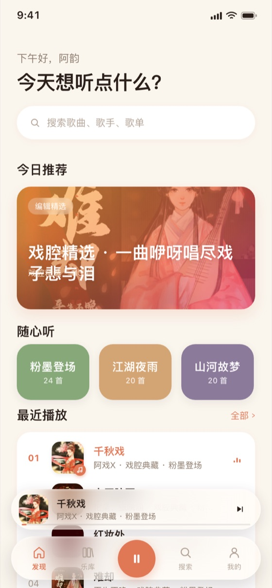
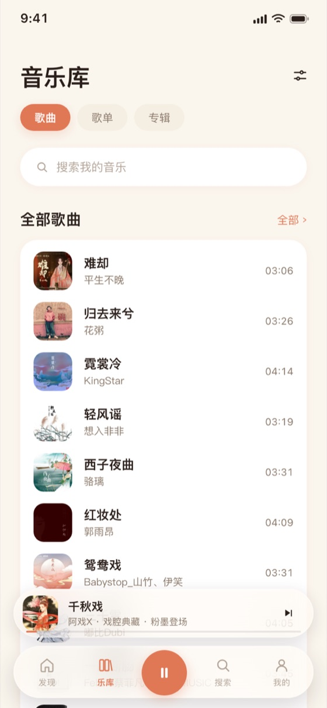
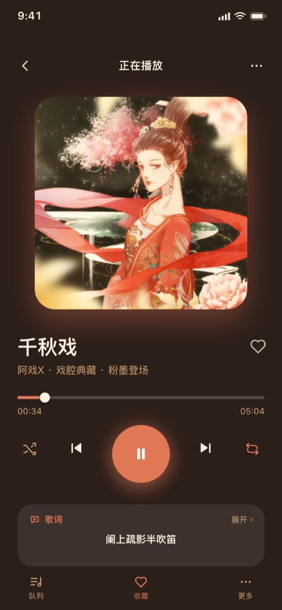
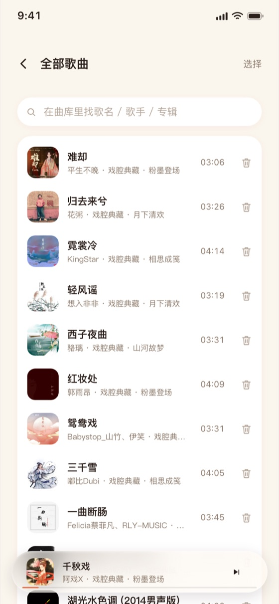
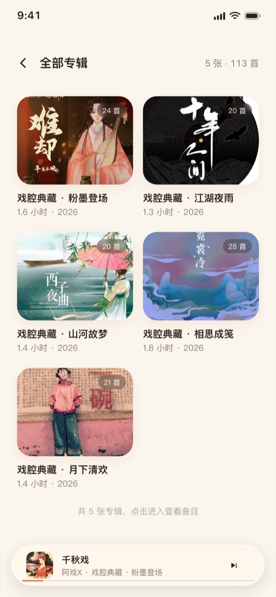
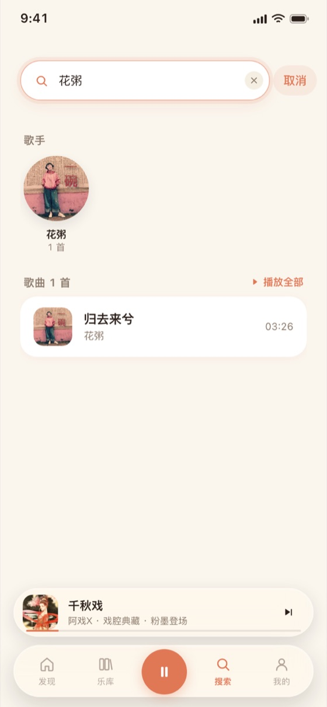

<div align="center">

# 韵律 · Rhythm

**一个自用的国风音乐库 App —— Vue 3 移动端界面 + FastAPI 后端，从曲库管理到歌词滚动全链路打通。**

移动端界面按 390 × 844 设计稿 1:1 还原，支持手机浏览器直接访问。

[界面预览](#界面预览) · [功能特性](#功能特性) · [技术栈](#技术栈) · [快速开始](#快速开始) · [接口一览](#接口一览) · [设计系统](#设计系统)

</div>

---

## 界面预览

<p align="center">
  
  
  
</p>

<p align="center">
  <sub>发现 · 音乐库 · 正在播放</sub>
</p>

<p align="center">
  
  
  
</p>

<p align="center">
  <sub>全部歌曲（筛选 / 批量删除） · 全部专辑 · 搜索（歌手 / 歌单 / 歌曲分组）</sub>
</p>

---

## 功能特性

### 浏览与发现
- **发现页**：按时段问候、今日推荐大卡、随心听（按合集切片，直接进歌单式播放）、最近播放、搜索入口
- **音乐库**：歌曲 / 歌单 / 专辑三个 Tab，卡片概览 + 行列表，卡片高度按实际条数自适应，不留空白也不裁切
- **全部歌曲**：歌名 / 歌手 / 专辑三字段筛选，支持「选择」多选批量删除（ActionSheet 二次确认）
- **专辑与歌手**：5 张「戏腔典藏」合集，专辑详情、歌手页；歌手无归属时按专辑表演者兜底，不会跳到空页
- **搜索**：250ms 去抖即时搜索，结果分「歌手 / 歌单 / 歌曲」三组并支持播放全部；关键词写回 URL，刷新与分享都能还原结果；本地搜索历史 8 条、热搜换一换、猜你喜欢

### 播放
- 全局播放态驱动：底部迷你播放条（下一首 + 播放进度条）、TabBar 中央播放键、整页「正在播放」
- 进度拖动、上一首 / 下一首、随机、循环（all / one / off）、队列管理（追加去重、移除、清空）
- 收藏、最近播放（同曲只保留最近一次，今日统计按曲目去重）、时间轴歌词滚动与歌词页

### 账号与设置
- 邮箱注册 / 登录，JWT 鉴权，Token 本地持久化，401 自动清理会话并带 `redirect` 回跳登录
- 我的页：资料卡、统计、歌单 / 收藏 / 最近播放入口、设置
- 设置页：音质、显示歌词、资源来源（服务器 / OSS）、缓存真实占用与一键清理、退出登录

### 数据
- 曲库按专辑聚合，支持合集与多位歌手（`阿戏X、伊笑`）
- 文案（问候语、区块标题、热搜池、合集简介）整块存 JSON，运营改文案不用动表结构

---

## 技术栈

| 层 | 选型 |
| --- | --- |
| 前端 | Vue 3.4（`<script setup>`）、Vite 5、vue-router 4、原生 CSS（设计令牌，无 UI 框架） |
| 后端 | FastAPI、SQLAlchemy 2.0、Pydantic v2、Uvicorn |
| 存储 | SQLite（单文件，开箱即用） |
| 部署 | Nginx 静态站点 + `/api` 反向代理，后端由宝塔 Python 项目管理 |

前端不依赖组件库，`src/styles/tokens.css` 统一色彩 / 圆角 / 阴影 / 字号，组件只消费令牌，换肤只改一处。

---

## 目录结构

```
rhythm-music/
├── web/                        # 前端（Vue 3 + Vite）
│   ├── src/
│   │   ├── views/              # 17 个页面：发现/乐库/全部歌曲/歌单/专辑/歌手/播放/搜索/我的...
│   │   ├── components/         # TabBar、MiniPlayer、SongRow、ActionSheet、各类弹层
│   │   ├── store/              # data / player / settings / auth（reactive + computed）
│   │   ├── api/client.js       # 统一请求、Bearer Token、错误体解析、401 处理
│   │   ├── styles/             # tokens.css 设计令牌 + base.css 设备外壳
│   │   └── utils/              # 格式化、导航
│   └── vite.config.js          # 开发期 /api、/covers 代理到 127.0.0.1:8000
├── api/                        # 后端（FastAPI）
│   ├── app/
│   │   ├── routers/            # auth / browse / songs / playlists / player / search / favorites / recent / me / assets
│   │   ├── models.py           # 11 张表：users、songs、playlists、player_state、content_blocks...
│   │   ├── services.py         # 聚合查询、统计、播放态推进
│   │   ├── seed.py             # 建库 + 示例曲库 + demo 账号
│   │   └── main.py             # 路由挂载、静态封面、CORS、统一错误格式
│   ├── data/seed/              # songs.json、lyrics.json
│   └── static/covers/          # 封面
└── docs/screenshots/           # README 截图
```

---

## 快速开始

### 1. 后端

```bash
cd api
python3.11 -m venv .venv && source .venv/bin/activate
pip install -r requirements.txt
uvicorn app.main:app --reload --port 8000
```

首次启动会自动建表、灌入示例曲库，并创建演示账号。接口文档：<http://127.0.0.1:8000/docs>

> 音频文件体积大（1GB+），仓库只保留封面与元数据；未配置音频的曲目会走模拟播放，界面与交互不受影响。

### 2. 前端

```bash
cd web
npm install
npm run dev        # http://127.0.0.1:5173 ，/api 已代理到 8000
```

生产构建：

```bash
npm run build      # 产物在 web/dist
```

### 演示账号

| 邮箱 | 密码 |
| --- | --- |
| `demo@rhythm.app` | `rhythm2026` |

也可直接注册新账号：注册后是一份空曲库，可从「全部歌曲」开始整理。

---

## 接口一览

统一前缀 `/api/v1`，除注册 / 登录外均需 `Authorization: Bearer <token>`。错误统一返回 `{"error": {"code", "message"}}`。

| 模块 | 代表接口 | 能力 |
| --- | --- | --- |
| 鉴权 | `POST /auth/login` | 注册、登录、当前账号 |
| 发现 | `GET /discover` | 首页聚合数据 |
| 乐库 | `GET /library` | 歌曲 / 歌单 / 专辑三 Tab |
| 专辑 / 歌手 | `GET /library/albums` | 专辑列表、专辑与歌手详情 |
| 歌曲 | `GET /songs` | 筛选、排序、分页、删除 |
| 歌单 | `POST /playlists` | 增删改查、加歌、播放全部 |
| 播放 | `POST /player/play` | 播放态、进度、随机循环、队列 |
| 搜索 | `GET /search` | 三组结果、热搜、猜你喜欢 |
| 收藏 / 最近 | `GET /recent` | 收藏、最近播放（同曲去重） |
| 我的 | `GET /me/profile` | 资料统计、播放设置 |

---

## 数据模型

```
users ──< playlists ──< playlist_tracks >── songs ──< lyric_lines
  │                                            │
  ├──< favorites >─────────────────────────────┤
  ├──< play_events >───────────────────────────┤
  ├──< queue_items ──> player_state             │
  └──< settings                    content_blocks（文案 JSON）
```

- `songs.album_artist`：合集类专辑的表演者，留空时回落到 `artist`
- `play_events`：一次播放一条，统计时按 `song_id` 去重
- `content_blocks`：`discover` / `albums` 等区块文案整块 JSON 存储

---

## 设计系统

| 令牌 | 值 | 用途 |
| --- | --- | --- |
| `--primary` | `#e07856` | 主色（夕阳橙） |
| `--honey` / `--sage` / `--plum` | `#d4a574` / `#87a878` / `#8c7a9b` | 随心听、热搜等彩色胶囊 |
| `--bg-canvas` / `--surface` | `#faf6ee` / `#ffffff` | 米色画布 + 白色卡片 |
| `--ink` / `--ink-sub` | `#2b1f1a` / `#8c7a6b` | 主文字 / 次级文字 |
| `--r-card` / `--r-btn` / `--r-tab` | `20px` / `24px` / `36px` | 卡片、按钮、悬浮 TabBar |

深色播放页单独一套 `--dark-*` 变量；`prefers-reduced-motion` 下动效自动降级。

---

## 部署

线上示例：<https://music.zhanglei928.com>（HTTPS，证书由 Let's Encrypt 自动签发与续签）

1. `npm run build` 产出 `web/dist`，交给 Nginx 作为站点根目录（`try_files $uri $uri/ /index.html` 兜底 SPA 路由）
2. `location /api/` 反代到 `127.0.0.1:8000`，`/covers/` 直接 alias 到封面目录并加缓存
3. 后端以 `uvicorn app.main:app --host 127.0.0.1 --port 8000` 常驻，`.env` 配置 JWT 密钥、API 前缀等
4. 80 端口 301 跳 443，`/.well-known/acme-challenge/` 单独放行以便自动续签；IP 直连仍保留 HTTP 入口

生产环境建议把 `RHYTHM_AUTO_SEED` 关掉，避免清空曲库后重启又被灌回示例数据。

---

<div align="center">
<sub>界面与交互按个人使用习惯打磨，配色取自「戏腔」主题舞台灯光。</sub>
</div>
